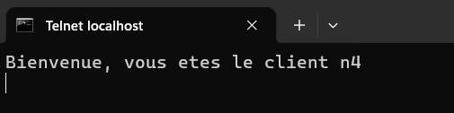
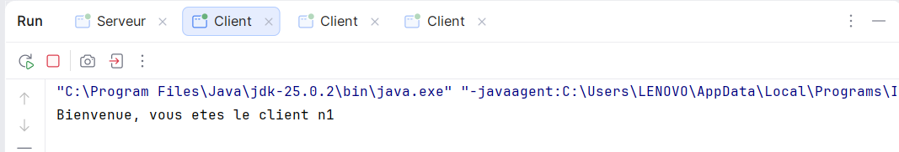
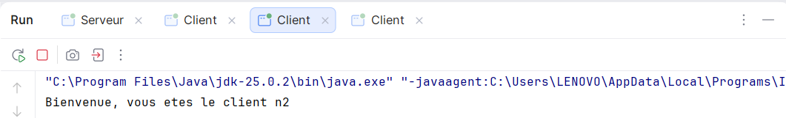
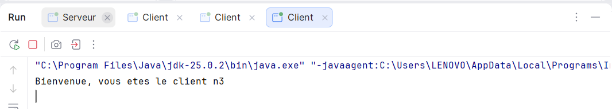
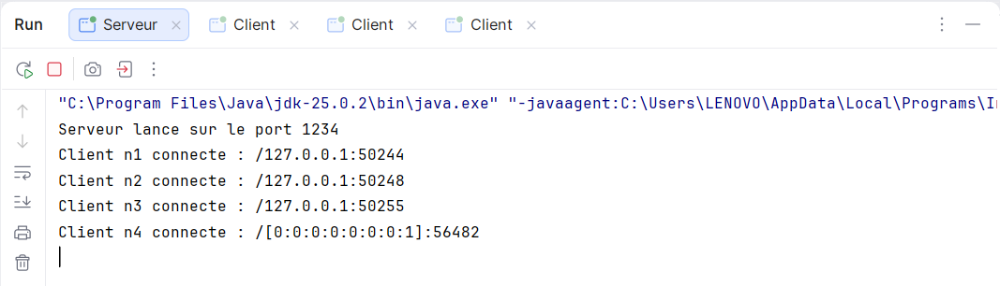
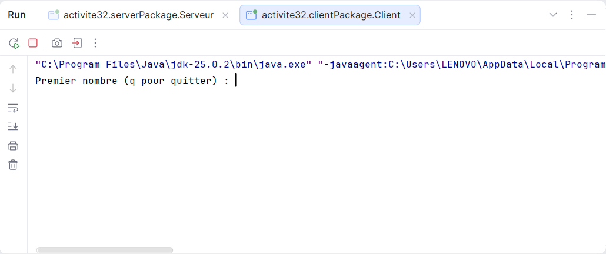
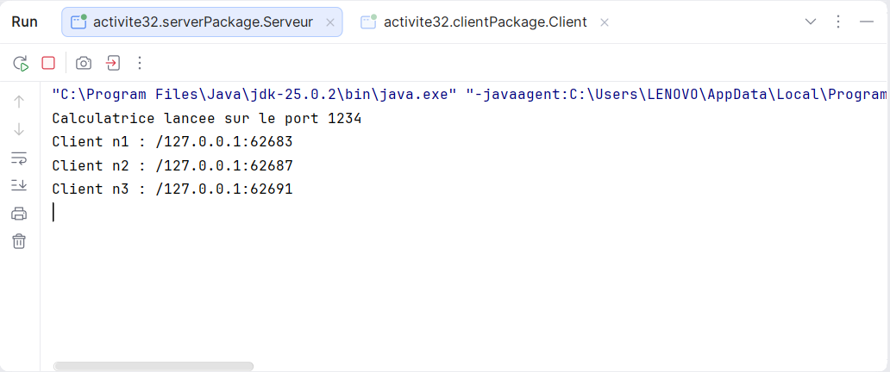
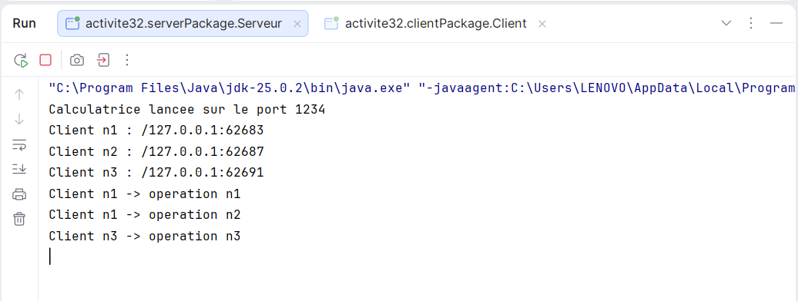

# TP3 - Serveur multi-threads (sockets TCP)

## Activité 3-1
Le serveur accepte plusieurs clients grâce à un thread par client. Il affiche
l'adresse IP et le numéro d'ordre de chaque client et le renvoie au client.

Tests :
- Clients Telnet : 
- Clients Java : 

- Serveur : 

## Activité 3-2
Calculatrice avec échange d'objets (classe Operation sérialisable).
Un compteur global synchronisé compte les opérations de tous les clients.

Tests : 

## Synthèse
(3-4 sentences: server creates one thread per client; accept() in a loop;
synchronized avoids two threads modifying the counter at the same time;
telnet and Java clients both work; what you observed on the network test.)

## Lancer le projet
Lancer Serveur puis Client (java activite31.Client <ip du serveur>).